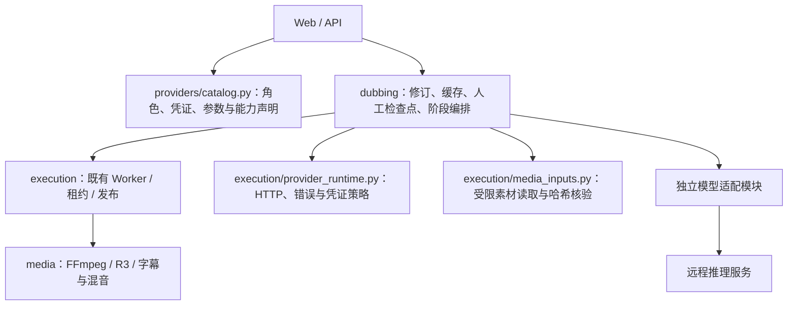

# 模型模块化与冗余流程审计

2026-11-02。审计对象是 Video Translate SaaS；VoiceStudio 作为上游源码对照。此次整理保留原有 HTTP API、适配器 ID、数据库结构、输入指纹和远端提交顺序，不重新生成样片。

## 与 VoiceStudio 的关系

上游核对版本：[cb1d6783a1c9e32044cce7137ab2fdde25c6c646](https://github.com/debpalash/VoiceStudio/commit/cb1d6783a1c9e32044cce7137ab2fdde25c6c646)。核心方法近似，但调度代码并不相同，也不能据此推断音质等价。

| 环节 | 上游核对结果 | 本项目边界 |
| --- | --- | --- |
| 调度与恢复 | 进程内异步队列，状态/事件可写入 SQLite；待执行工作本身不持久化，重启后的未完成任务标为失败。 | 独立 SQL Worker，通过租约、心跳和检查点恢复；完整流水线复用同一个 Worker，不另建调度器。 |
| 配音与缓存 | 每语言、每句自然音频缓存；TTS 与拟合指纹分开，支持只重拟合/重混。 | 保留自然音频、选定版本、QC、FitPlan 和 render/mix/export 的不同身份与当前性。 |
| 翻译策略 | Fast/Cinematic/Autofit；部分已经过 LLM 的路径会跳过额外反思/改写。 | 各翻译阶段是独立持久化命令；不是对上游全部分支的逐行复刻。 |
| 远端重试 | 本地 GPU OOM 可降低步数重试。 | 不能直接套用到可能计费的远端 POST；保留提交不确定状态与已有请求 ID。 |

来源：[tasks.py](https://github.com/debpalash/VoiceStudio/blob/cb1d6783a1c9e32044cce7137ab2fdde25c6c646/backend/core/tasks.py#L47-L84)、[job_store.py](https://github.com/debpalash/VoiceStudio/blob/cb1d6783a1c9e32044cce7137ab2fdde25c6c646/backend/core/job_store.py#L170-L183)、[项目与素材缓存](https://github.com/debpalash/VoiceStudio/blob/cb1d6783a1c9e32044cce7137ab2fdde25c6c646/backend/services/dub_pipeline.py#L325-L396)、[增量生成](https://github.com/debpalash/VoiceStudio/blob/cb1d6783a1c9e32044cce7137ab2fdde25c6c646/backend/services/incremental.py#L52-L101)、[翻译分支](https://github.com/debpalash/VoiceStudio/blob/cb1d6783a1c9e32044cce7137ab2fdde25c6c646/backend/api/routers/dub_translate.py#L389-L425)。未复制上游 AGPL 实现。

## 当前模块边界

| 适配模块 | 模型/协议职责 | 保留的配置 ID |
| --- | --- | --- |
| `providers/chat.py` | Qwen 或其他 HF/OpenAI-compatible LLM，结构化翻译与实际返回用量 | `hf_router`、`openai_compatible` |
| `providers/whisper.py` | Whisper 来源识别与独立配音识别 | `hf_asr`；verification 角色的 `hf_router` |
| `providers/demucs.py` | 两轨/四轨分离的准备、提交参数与结果归一化 | `demucs`、`demucs_multistem` |
| `providers/omnivoice.py` | 声音克隆准备、语言/参数映射与结果校验 | `omnivoice` |
| `providers/nvidia_stream.py` | 带说话人标签的流式识别 | `nvidia_stream` |

`providers/catalog.py` 是七种适配器配置声明的唯一来源；声明本身不可修改，不持有运行任务或数据库事务。`providers/network.py` 和 `gradio.py` 是公共协议/网络层。`models/` 是数据库 ORM，不是 AI 模型目录。

公共传输、失败映射、HF 凭证解析和素材读取不再由“源分析”或“声音合成”阶段向其他阶段提供。各阶段仍拥有自己的提交边界和发布检查；翻译的同步提交不确定策略与其他阶段的错误映射保持区别。公开链接下载采用单独的 HTTP 边界，不能因函数名称类似就与模型网络客户端合并。

## 删除与保留依据

删除已确认没有生产调用者的一次性 `translate`、`submit_clone`/`poll_clone`、`submit_separation`/`poll_separation` 及其专用 `RemoteResult`；主流程使用有检查点的准备/提交路径和公共 Gradio 协议。相关凭证、请求、结果和超时测试转向这些实际生产入口。

删除混合 Chat/ASR 的旧 `hf_router.py` 文件以及未被打包使用的 `web/nginx.conf`，部署网关统一为 `deploy/nginx.conf`。

两项静态扫描疑似冗余经核实保留：

- `httpx2`：当前 Starlette TestClient 实际导入的开发依赖，不是可直接删除的闲置包。
- `normalize_translation`：实际被 `chat_data`/`normalize_chat` 使用，保证行 ID、覆盖范围与文本类型正确。

`pipeline_control.py` 的 dirty wake pump、源分析 workflow、租约、取消、缓存来源证明、迁移历史和人工试听记录均有实际调用和不同职责，保留。已跑通的样片、私有素材、凭证、数据库与备份不属于此次代码删除范围。

## 后续敏捷开发

- 同一协议下更换模型：修改受保护配置并验证能力，不改 Worker。
- 接入新协议：增加独立适配模块、catalog 声明、必要的阶段接入及契约测试；不复制任务系统。
- 性能优化先定位准备、网络排队/生成、轮询、素材读取、拟合、混音和封装中的具体阶段。已有 Run/Attempt/Operation/事件继续记录实际数据，不另建进度或计费系统。
- `make check` 是快速模型契约、静态检查及前端验证；`make test` 是需要隔离 PostgreSQL 和完整媒体工具的全量检查。它们不是同一覆盖范围。
- CI 只运行显式测试提供方和本机生成的测试素材，不提交真实推理。远端 CI 只有推送后才会触发；本次没有推送或上线。

## 本次验证（2026-11-02）

- `make check`：147 项后端模型/运行时/网络/配置契约测试通过（26.08秒）；21个文件的127项前端测试通过（7.46秒）；TypeScript 与 Vite 生产构建通过。
- Ruff 检查和249个 Python文件的格式检查通过；冻结锁文件核对77个包。
- `make package`：sdist 和 wheel 构建通过。检查 wheel 包含拆分后的模型、catalog、公共运行时/素材读取与语言数据，且没有旧 `hf_router.py`；sdist 仅保留 `deploy/nginx.conf`。
- CI YAML、事件、只读仓库权限和固定到40位提交哈希的 Action 引用已检查。远端 CI 未运行；本次没有重复执行完整后端媒体回归，也没有调用真实推理。
