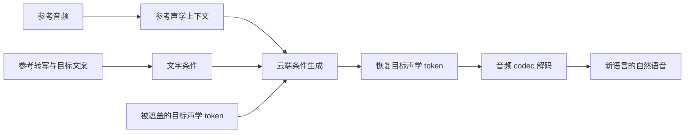

# Voice dubbing：模型为什么能换语言并保留声音

这份说明区分模型原理与当前工程验证。5A自然音频、5B独立复核、6A时间映射已通过各自独立审查；6B1持久化计划正在构建。它不是最终混音、字幕、视频、完整工作台或云端部署的验收报告，交付时仍需按最终接口补齐完整工程流程图。

## 模型生成新语音的方式

OmniVoice以文字和参考声学上下文为条件，用双向Transformer恢复被遮盖的多码本声学token，再由音频codec生成波形。这里的扩散语言模型是离散token恢复过程。随机遮盖训练和LLM权重初始化分别帮助学习补全和语言表达；这些是模型设计，不是本项目已经验证的音色质量结论。[论文v3，§2.1](https://arxiv.org/html/2604.00688v3#S2.SS1)

可以把接口中的两组输入理解为：目标文案指定内容，参考音频及其准确转写提供声音示例。官方克隆接口要求`ref_audio`和`ref_text`，推荐3–10秒参考；文档也说明跨语言克隆可能带有参考语言的口音。因此，英语参考生成中文／日语仍需检查口音、可懂度和人物声音。[固定版本使用说明](https://github.com/k2-fsa/OmniVoice/blob/08be0b4ccbac3e13e374e86fbfead4b4cac343e2/README.md#voice-cloning)

## 配音产品还需要解决什么

视频配音需要先得到可编辑的原文和角色，再翻译为目标文案，逐句调用声音克隆。原视频中的音乐与环境声另行保留；生成的自然语音需要测量、复核并放回共同时间轴。模型输出一段音频，并不自动完成这些工程步骤。

当前工程的具体边界如下，链接指向实现而非效果承诺：

| 工作 | 实现位置 | 独立证据／边界 |
| --- | --- | --- |
| 参考音频、准确转写、角色默认与单句覆盖 | [references.py](../../src/videotranslate/dubbing/references.py) | 单句绑定优先；引用精确版本和实际音频哈希 |
| 目标文案、上下文、术语与翻译阶段 | [remote_translation.py](../../src/videotranslate/dubbing/remote_translation.py) | 各阶段保留独立请求、编辑与重试状态 |
| 每句云端克隆及恢复 | [remote_synthesis.py](../../src/videotranslate/dubbing/remote_synthesis.py) | 真实请求ID、下载和完整解码分别检查；自然音频不等于最终混音 |
| 独立识别与人工试听 | [voice_qc.py](../../src/videotranslate/dubbing/voice_qc.py)、[qc_comparison.py](../../src/videotranslate/dubbing/qc_comparison.py) | 独立ASR不接收期望文案作为识别提示；文字匹配不证明音色、发音或真人接受 |
| 多角色／多目标共同时间映射 | [fit_plan.py](../../src/videotranslate/media/fit_plan.py) | 重叠采用共同最大因子；当前只验证了规划计算，实际媒体另行验收 |

多角色的关键是每句明确解析到哪个参考版本，而不是把整段混合说话声都当作一个人物示例。翻译、自然音频、所选版本、识别证据、试听记录、适配与导出也需要分别保留身份：改字幕颜色不会要求重新克隆，改配音文案则会影响对应自然音频；改变时间位置主要影响后续适配。这是本工程的依赖设计，具体失效／恢复行为由各阶段测试证明。

本项目走HF远程接口，没有安装模型权重或在本机运行模型。官方模型卡、代码和应用的来源／使用条件另见[来源记录](sources.md)；模型论文、目录646项、官方演示和本项目实际样片验收是不同层次的证据。主样片中／日目标翻译的两个旧上下文请求仍待单独重试确认，尚不能把诊断用的短中文音频当作完整样片。

来源版本：GitHub代码说明`08be0b4ccbac3e13e374e86fbfead4b4cac343e2`（README blob`014ae45f62ff09c3f66a0b9a0d1b83dbadad0c96`）；HF模型卡`c5fdb5ccb189668d56333f77ba2629f4cd7535f4`。两者属于不同仓库，不能互换commit来查询源文件。研究仅阅读文档／论文，未下载或执行本地模型。
