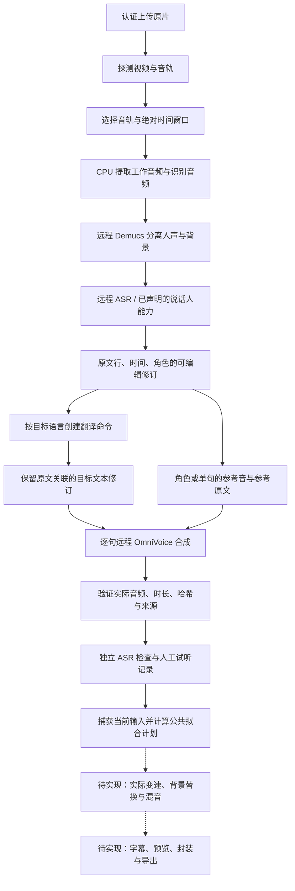
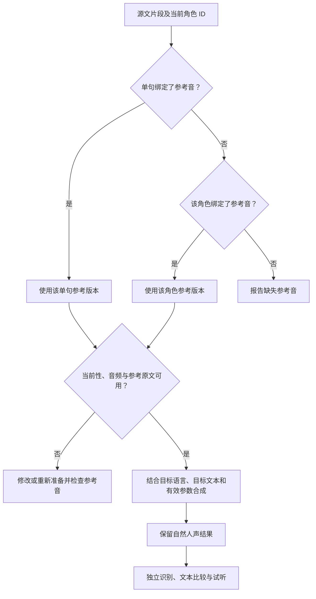
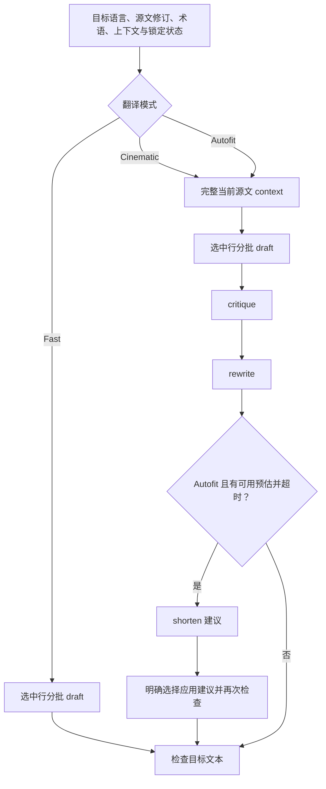
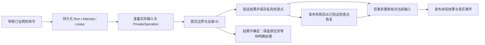

# Video Translate 配音、角色与翻译源码流程

核对版本：源代码 `32e9dc2`。本文把已经实现的后端路径与源码对应起来。主任务仍包括实际媒体处理、完整工作台与真实样片验收。6B1 已通过规格和质量复核，6B2A 正在实现实际媒体处理；开发预览的版本另见激活记录。下方虚线表示后续媒体实现，不能作为已有输出证明。

## 上传、识别、翻译到配音

实际边界：`WorkflowIntent` 目前串联提取、分离和识别，停在原文/角色检查；翻译、合成、QC、拟合各自有持久化命令。完整跨阶段自动推进仍要接入这些命令。用户选择的自动推进开关不能代替尚未实现的后续编排。

源码入口：[`analysis.py`](../../src/videotranslate/dubbing/analysis.py)、[`workflow.py`](../../src/videotranslate/dubbing/workflow.py)、[`translation_workflow.py`](../../src/videotranslate/dubbing/translation_workflow.py)、[`remote_synthesis.py`](../../src/videotranslate/dubbing/remote_synthesis.py)、[`remote_voice_qc.py`](../../src/videotranslate/dubbing/remote_voice_qc.py)、[`fit_execution.py`](../../src/videotranslate/dubbing/fit_execution.py)。原片/角色/译文/音频各有自己的修订和来源记录。

## 多角色：每句到底用哪份声音

[`resolved_reference`](../../src/videotranslate/dubbing/synthesis.py) 按“单句→当前角色”的顺序选择引用。没有引用的单句版本可以继承角色；已经选中的单句参考若过期或不可用，会明确报错。角色 ID 是工作标签；识别原始标签保留在来源结果中，也可以人工分配角色。

参考音可以从选中源片/分离人声中提取，也可以上传，再形成不可变的参考版本。短/长等实际测量警告由操作者对具体参考版本检查。绑定更新有版本与 CAS；旧参考和旧结果保留历史。

参数由 [`effective_controls`](../../src/videotranslate/dubbing/synthesis_settings.py) 解析：先取提供方设置，再依次应用目标轨道、单句的有效覆盖。每个有效覆盖是一套完整参数；取消覆盖恢复继承。声音引用与合成参数是两条独立版本链。修改被单句覆盖遮蔽的轨道默认值，不应重新生成那句未受影响的声音。

合成缓存绑定实际目标文字、规范语言、参考音哈希/原文、模型与有效参数，并检查原生产操作和音频来源。自然人声保留原始测量与哈希；后续拟合产生派生音频。音色克隆的模型原理与局限另见[参考条件与离散音频生成说明](voice-dubbing-model-principle.md)。

## 多语言翻译：三个模式的实际路径

每个 context、draft、critique、rewrite、shorten 都有独立阶段、请求/缓存和发布记录。上下文阶段生成的摘要/术语保留为生成版本，并不覆盖用户提供的上下文头。draft 和 rewrite 发布新的目标文本修订，默认仍需检查；锁定行和明确强制替换分别处理。shorten 的产物是建议，应用时重新检查当前来源与行修订。

Fast 的输入集中在选中行；Cinematic/Autofit 的自动上下文依赖完整源文，相关源文变更会影响后续阶段。各目标语言有独立轨道、上下文、文字、合成和 QC 历史；一条目标的单句编辑不会自动替换另一条目标。

[`estimate_ms`](../../src/videotranslate/dubbing/remote_translation.py) 仅为少数语言提供字符/词速率启发式预估，其他语言返回未评估。预估不是 TTS 的实测时长。实际拟合使用已验证自然人声的测量，并可返回具体超限问题。

## QC、拟合与失败恢复

独立 QC 把选定自然人声的实际字节转为识别输入，不把期望目标文字或参考原文传给识别器。识别结果随后与当前期望文字比较；缺失语言信息保留未知。识别相似度与人工试听状态分别记录，音色/发音主观检查需要实际试听。新增不利证据需要操作者确认；自动相似度不能替代试听。

普通 `dub` 拟合要求每个目标的完整当前源行集，以及每句可用、当前并已满足试听/证据条件的选定音频。`incomplete_preview` 保存显式子集及缺失项，并永久保留预览用途；`original_only` 只有原片身份映射。可计算、输入仍当前、音频可用、可渲染是不同字段。数学超限会保留问题与空的拟合端点，供人工处理。

现有 Worker 保存租约、尝试、事件和检查点。已知远端句柄可继续查询；不确定的已提交请求保留原记录，按明确确认约定处理重试。准备成功后的发布失败可以复用经过严格来源校验的结果。当前输入改变会使旧结果成为历史，不覆盖操作者的新修订。事件保留安全 ID、计数、状态与实际测量；服务令牌、原始请求头、存储路径和签名链接不进入公开事件。

公共拟合计划已经有独立命令和 CPU JSON 计算，但实际视频变速、每目标背景掩码、浮点混音/保护、字幕和多音轨导出仍属后续实现。以上源码图还需在最终媒体与跨阶段编排接入后更新；完整范围见[剩余产品义务](remaining-product-obligations.md)。
