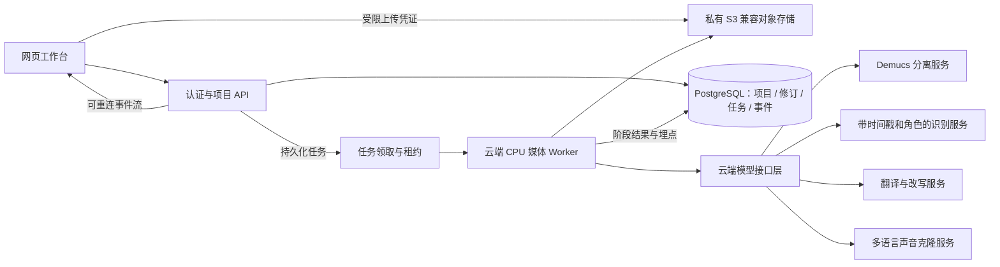
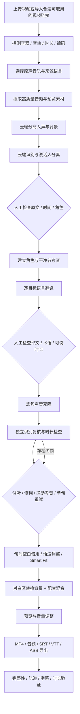
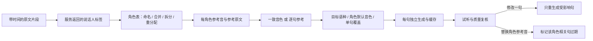
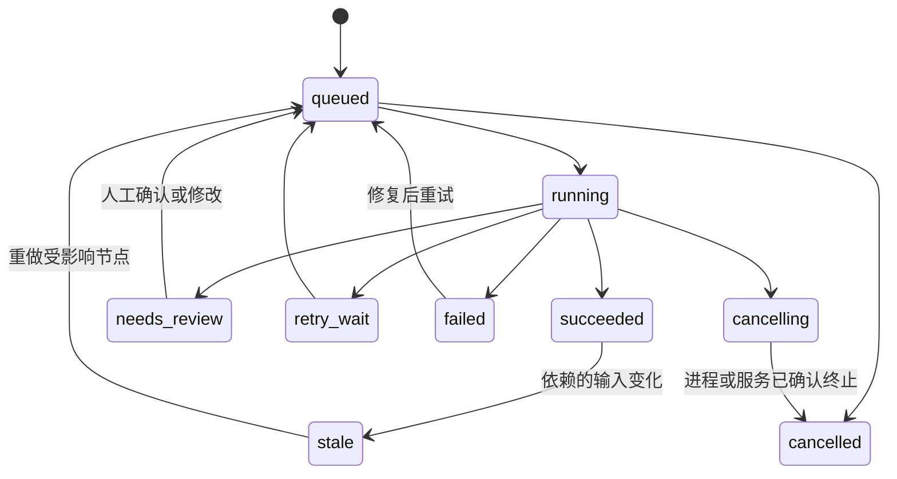

# Video Translate · SaaS 产品与技术设计

日期：2026-10-29。状态：用户已确认方案 A，并授权继续完整构建。确认于 2026-10-29。

## 1. 用户已确定的目标

构建以视频内音频翻译与多角色配音为核心的独立 SaaS。用户在网页上传原始视频，调用云端模型完成识别、角色区分、翻译、声音合成、质量检查、背景混音及字幕/视频导出。全过程可查看进度、人工修改、按失败节点或单句重试。开发机不下载或运行 AI 模型。

产品名暂定 Video Translate。当前目录只有两次样片的素材、处理脚本和输出，不是已有 SaaS 仓库。另有 Voiceline 本机旁白项目可参考其测试经验，但其系统声音回退与本机模型方式不作为本产品的配音实现。

先跑通真实云端处理闭环，同时保留完整目标。账号和数据隔离、任务持久化、完整配音链路是 SaaS 的组成部分；收费套餐、营销站、组织计费和口型重绘不加入这次范围。

## 2. 三种方案及选择

| 方案 | 实现 | 优点 | 代价 |
|---|---|---|---|
| A · 推荐 | 独立 SaaS 编排层 + 可替换云端模型接口 + 云端媒体 Worker | 适合逐句编辑、断点恢复、多租户；模型和服务可替换；不绑定桌面程序 | 需要实现任务状态、编辑失效规则、云端服务适配 |
| B | 把完整 VoiceStudio 后端部署到云端，增加 SaaS 网关 | 原有配音选项复用较多 | 包含其他音频功能与较重运行环境；需要处理上游代码许可及多租户边界 |
| C | 调用一体化视频翻译 SaaS | 最快接入一个完整结果 | 中间角色、字幕、参考音及失败节点往往不可控；不能充分覆盖本任务 |

建议采用 A：按 VoiceStudio 配音能力独立实现 SaaS 工作流，复用同类云端模型能力和公开语言标准。上游应用代码只作行为和接口研究，不直接整包复制到新产品。若后续选用 B 或抽取上游实现代码，单独保留来源和对应许可，不能把 AGPL 实现当作无许可的专有代码。

## 3. 架构与边界

- 前端：React + TypeScript，视频预览、对白编辑、角色面板、翻译配置、任务与导出界面。
- API：Python FastAPI，处理身份、项目权限、编辑修订、任务命令及导出访问控制。
- Worker：同一后端工程中的独立进程，领取持久化任务，调用云端模型，使用 FFmpeg 做媒体提取、切片、混音、字幕及封装。Worker 不安装 PyTorch、Whisper 模型或 OmniVoice 权重。
- 存储：生产使用私有 S3 兼容对象存储，可配置 R2。开发测试可用文件存储适配器，但该适配器不作为已上线 SaaS 的证明。
- 数据库与队列：PostgreSQL 记录任务、租约和事件；Worker 原子领取任务，心跳续租，重启后恢复。避免仅使用进程内后台任务。
- 交付包含容器镜像构建文件、数据库迁移、Web/API/Worker 启动方式及云端部署说明。公开生产发布是独立步骤，不能用本机预览代表已上线。

## 4. 视频上传至导出主流程

导入视频链接是上传之外的入口，经过相同探测、权限和媒体处理逻辑。下载器拒绝内网地址和不支持的协议；不会将用户浏览器 Cookie 或其他站点凭证复制到服务端。

默认在原文检查和译文检查处暂停等待人工继续。用户可对单个项目启用自动推进；低置信度角色、缺失参考音、不可满足的时长和缺失配音仍须显示具体问题，不能悄悄替换成系统声音。

## 5. 语言支持

研究基线：VoiceStudio 提交 `5abc33602d17b81805731717b2a117857a98751c`。

已核对：`electron/src/shared/languages.json` 共 647 项，含 Auto；语言代码映射共 646 项。这是 OmniVoice 合成语言目录，不代表识别、机器翻译和质量识别均覆盖 646 种语言。

实现要求：

1. 保留全部 646 种语言及 Auto，记录名称、代码、别名、文字方向与上游版本；区域变体单独保存，不能把三字母语言码随意截成两字母。
2. 分别维护 ASR、翻译、TTS、QC 的服务能力。选择目标语言时展示完整目录，以及当前服务是否可处理。
3. 云端 OmniVoice 适配器按上游支持的规范名称传参；其他引擎只能使用其声明支持的语言。
4. 非识别服务支持的来源语言，可导入带时间的人工原文和角色信息，继续翻译与配音；不能声称已自动识别。
5. 翻译服务不支持时可换服务、人工输入或导入译文；不能静默生成其他语言。
6. 支持 RTL 文本、中文/日文等无空格文本及区域变体。字幕选择字体前检查对应字符覆盖。
7. “目录覆盖”“服务声明支持”“已实测语言对”分别记录。验收至少实测中译英、英译中、多角色、另一个语种以及 RTL 编辑与字幕案例，不把这些实测扩写成 646 种语言均已验证。

## 6. 多角色配音

- 说话人标签是可修改的工作标签，不自动声称已识别人物真实身份。
- 可调整说话人数、重分配单句角色、合并角色、拆分一段内的两个人、添加新角色、给单句覆盖默认音色。
- 默认一致音色：同一角色使用同一份参考音与参数。逐句参考是明确可选项。
- 参考音记录原视频范围、实际文件、原文、来源角色、时长和版本。参考音含噪、太短或混入另一人的声音时显示问题，支持人工替换。
- 默认逐句合成，避免上次样片中按角色拼成长段再切句而串入相邻单词的问题。仅当服务真正返回可靠的分句边界时才允许批处理优化。
- 情绪/方向、语速、发音说明与随机种子按服务能力呈现；不支持的控制不显示为可用。
- 克隆结果若带入参考原文、漏词或多读词，进入复核状态。自动识别只提出问题，不用粗糙词级时间戳直接裁掉单词后宣称修复完成。

## 7. 翻译方案

| 模式 | 行为 | 人工控制 |
|---|---|---|
| 快速 | 一次翻译，保留语义和原文修订 | 可逐句改写，导入人工翻译 |
| 自然对白 | 全片摘要与术语表 → 初译 → 语境与口语修订 | 对比草稿与修订，锁定姓名、术语和已批准句 |
| 时长适配 | 自然对白 → 估计目标语言朗读时长 → 提议较短表达 → 实际合成验证 | 不自动覆盖已锁定文本；显示缩短建议与实际时长 |

接入 OpenAI-compatible 翻译接口，支持平台配置的模型和端点；云端机器翻译作为独立适配器。第一条真实链路采用可配置云端 LLM，并保留外部 SRT/VTT/编号文本导入。接入服务的能力范围、版本、超时及重试按统一合同管理，不把本地 Argos/NLLB 安装作为前置条件。

数据以稳定片段 ID 对齐。整片摘要、术语表与原文修订形成上下文；目标语言的译文独立保存，不能覆盖原文或其他语种的译文。人工修改保持其来源记录，重译前明确哪些句会被替换。来源文本作为待处理数据，不接受其中对模型或系统发出的操作指令。

## 8. 拟合、混音与导出

- 保持画面时长：优先缩短译文或借用下一句前的空白，随后允许配置范围内的音频变速；超过范围的句子进入人工处理，不能切掉尾词。
- Smart Fit：必要时局部延长画面；维护统一时间映射，视频、所有角色、背景和字幕使用同一映射。多人重叠区共享视频时间线，不能按角色分别拉长后拼接。
- 对白区使用分离后的背景声，其余范围保留原声；边界交叉淡化。背景、配音分别调节增益，最终做峰值保护并记录调整值。
- 混音修改只影响混音和导出，不触发翻译或声音生成。字体、字幕样式修改只影响相应导出。
- 视频可保留原声音轨，选择一个或多个目标语音轨以及默认播放轨道。
- 支持 MP4、配音 WAV/MP3、SRT/VTT/ASS，支持原文、译文和双语字幕及烧录字幕。
- 导出必须确认需要的句子使用当前修订；缺句不能默认用旧文件或无声占位。用户若明确选择带缺句预览，应标注预览性质。
- 验证音画时长、音轨与语言标记、字幕数量/顺序/时间、字体覆盖、解码完整性、输出非空与缓存来源版本。

## 9. 编辑、失效和重试

| 人工修改 | 标记过期的结果 | 可以复用的结果 |
|---|---|---|
| 选择另一个原声音轨 | 分离、识别、参考音、翻译、配音、混音、导出 | 原始视频文件 |
| 更正原文 | 对应句各语言翻译、配音、QC、混音和导出；依赖该原文的参考文本 | 其他未受影响句的音频与其他角色参考音 |
| 调整句子时间 | 参考音、受影响句拟合、混音、字幕和视频时间映射 | 文本与无需更换参考的自然语速配音 |
| 改译文 | 对应目标语种对应句的配音、QC、拟合、混音、导出 | 原文、其他目标语言及其他句 |
| 改角色归属/参考音 | 该绑定影响的角色相关句配音、QC、拟合、混音、导出 | 不相关角色及显式单句音色覆盖 |
| 调整背景/配音音量 | 混音和导出 | 识别、翻译、自然语速配音 |
| 改字幕字体/烧录选项 | 对应导出 | 识别、翻译、配音、混音 |

每份结果绑定输入修订和内容指纹。过期结果可查看但不能冒充当前结果。长任务完成时若输入已被修改，结果进入旧版本，不能覆盖最新编辑。

自动重试仅覆盖可恢复错误，采用有限次数的指数退避；凭证失效、服务未配置、语言不支持等需要明确处理。保存远端请求 ID，网络轮询超时后继续查询同一请求，不能自动重复提交导致重复收费或生成。

## 10. 关键节点埋点与可观测性

事件覆盖：上传开始/完成、音轨选定、探测完成、分离开始/完成、识别开始/完成、角色修改、参考音变更、翻译开始/完成、人工改译、单句生成开始/完成、QC 提示、拟合策略变化、混音预览、导出验证、取消、重试、失败及恢复。

每个事件记录 workspace/project/run/stage/segment/target_language/attempt、输入修订、提供方与模型、远端请求 ID、持续时间、实际进度、错误分类、是否可重试、输入输出文件摘要。成本只记录服务实际返回值或清楚标记的估算，不凭空展示费用。

事件持久化并按序号提供可重连事件流。浏览器刷新能还原状态、查看最近失败原因并定位到对应句子。日志默认不写入密钥、完整请求头、签名 URL 或整段私有对白。

## 11. 数据与 SaaS 权限

核心实体：User、Workspace、Membership、Project、Asset、SourceTrack、Segment、Speaker、VoiceReference、LanguageTrack、TranslationRevision、VoiceBinding、StageRun、SegmentRun、Artifact、Event、Export。

所有项目、素材、任务、事件与下载访问均按工作区鉴权；知道另一个项目 ID 不应获得其数据。普通工作区可由一个用户拥有，数据结构允许后续邀请协作者。本次提供注册/登录/退出、工作区归属与基础权限，不加入复杂企业组织功能。

密钥仅进入服务端配置或受保护的配置接口，数据库保存时加密，客户端只能看到是否已设置。生产 Cookie 使用安全属性，并提供 CSRF 防护、登录限速、文件大小/时长约束、媒体内容探测、路径保护和远端 URL 访问限制。导出使用受限下载或短期签名地址。

## 12. 工作台页面

1. 登录与项目列表：新建项目、上传、最近处理状态、来源语言和目标语言。
2. 编辑工作台：视频/音轨切换预览、流程进度、原文与译文对照、单句时间和角色、角色音色面板、底部时间线。
3. 翻译设置：目标语言、模式、术语表、来源上下文、已锁定句、导入译文。
4. 质量与任务：失败定位、单句试听、额外/缺失词提示、时长问题、节点重试和取消。
5. 混音与导出：背景/配音增益、原声保留、字幕样式、目标轨道、预览和下载。
6. 服务设置：云端端点连接测试、语言能力、凭证状态与明确的服务错误。

语言目录来自后端，提供搜索、常用语言及 RTL 处理。用户页面不暴露底层命令、GPU 安装或本机模型下载步骤。

## 13. 云端服务与首条真实链路

接口按 separation / transcription+diarization / translation / synthesis / verification 拆分。已核对官方 fal Demucs 支持 htdemucs 及 WAV 输出；Hugging Face 提供时间戳识别接口；OmniVoice 官方 Space 已在前两次样片验证过云端声音克隆。具体启用服务由可用凭证、语言覆盖与模型许可共同决定。

第一条链路优先复用已验证的云端模型路径，同时为稳定托管端点保留相同适配接口。免费交互 Demo 的额度、排队与可用性属于实际外部依赖，页面必须显示这些状态，不能把 Demo 标为有生产 SLA 的服务。

原文/角色缺少可靠自动结果时允许人工修正后继续，这是正式工作流，而不是将人工输入伪报成自动识别。完整验收仍需至少一条真实上传、云端自动识别与角色结果、翻译、克隆、混音和导出的运行证据。

开发机不运行模型。开发阶段可在本机运行 API 和 FFmpeg 做集成验证；生产的模型请求、素材与媒体任务在云端执行。开发预览、云端集成实测、线上部署、商用准备分别报告。

## 14. 上游映射与模型许可事实

| 能力 | 研究来源 |
|---|---|
| 上传、提取、分离、识别、角色与参考音 | `backend/api/routers/dub_core.py`、`backend/services/dub_pipeline.py` |
| 一致角色音色、逐句覆盖与重生成 | `backend/api/routers/dub_generate.py` 的 consistent reference 与单句生成逻辑 |
| 语言和区域别名 | `docs/languages.md`、`electron/src/shared/languages.json`、`language-codes.json` |
| 翻译模式和外部译文 | `docs/dubbing/translation-engines.md` |
| 背景对白区替换与混音 | `backend/services/dub_background.py`、`dub_mix.py` |
| 独立识别 QC | `backend/services/dub_qc.py` |
| 字幕与视频导出 | `docs/dubbing/export.md`、`backend/api/routers/dub_export.py` |

VoiceStudio 应用声明 AGPL-3.0。OmniVoice 官方模型卡声明代码 Apache-2.0、预训练模型 CC-BY-NC。应用许可不等于权重或生成内容的商用许可；本设计不宣称使用这些模型即可开展收费服务。产品保留研究验证路径和可替换商用模型接口，模型选择展示来源与用途信息。正式收费发布需使用相应用途获准的服务或权重。

来源：

- [VoiceStudio 多角色流程](https://github.com/debpalash/VoiceStudio/blob/main/docs/dubbing/multi-speaker-guide.md)
- [VoiceStudio 翻译](https://github.com/debpalash/VoiceStudio/blob/main/docs/dubbing/translation-engines.md)
- [VoiceStudio 语言](https://github.com/debpalash/VoiceStudio/blob/main/docs/languages.md)
- [VoiceStudio 导出](https://github.com/debpalash/VoiceStudio/blob/main/docs/dubbing/export.md)
- [VoiceStudio 许可说明](https://github.com/debpalash/VoiceStudio/blob/main/LICENSE-NOTICE.md)
- [OmniVoice 官方模型卡与许可](https://huggingface.co/k2-fsa/OmniVoice#license)
- [fal Demucs API](https://fal.ai/models/fal-ai/demucs/api)
- [HF 时间戳识别 API](https://huggingface.co/docs/inference-providers/en/tasks/automatic-speech-recognition)

## 15. 实现顺序与完成证据

保持完整范围，按能独立验证的顺序实现：

1. 建立独立仓库、上述设计和上游映射，建立接口及修订数据模型。
2. SaaS 项目基础：账号、工作区权限、上传、私有素材、数据库迁移、API/Worker 分离。
3. 持久化任务图、事件、节点重试、取消、租约恢复、输入修订和失效传播。
4. 646 语言目录和服务能力矩阵，云端服务配置与连接测试。
5. 云端分离、识别、多角色与参考音管理，人工校对及字幕导入。
6. 多目标语言翻译、术语和上下文、三种模式、人工编辑和锁定。
7. 逐句克隆、按角色一致音色、单句覆盖、缓存与质量复核。
8. 拟合、背景混音、试听、字幕及多音轨导出。
9. 完整工作台接线及错误、空状态、重连和重试界面。
10. 真实云端模型集成实测、浏览器端到端验证、失败恢复验证、部署产物和运行文档。

| 验收项 | 直接证据 |
|---|---|
| 语言目录完整 | 同步来源与版本、646 项集合比对、别名/区域/RTL 用例 |
| 上传至导出 | 一次新上传的真实视频及完整运行事件、真实服务结果、最终可播放文件 |
| 多角色 | 至少两位说话人、角色改派、参考音变更、单句覆盖与选择性重生成实测 |
| 多语言翻译 | 中英双向及额外语种的真实结果，术语和锁定句用例，不覆盖原文 |
| 人工修改 | 改文本、时间、角色、音量后只使对应依赖失效，旧结果不会覆盖新修订 |
| 失败恢复 | 注入额度、超时、中断与单句失败；刷新/Worker 重启后查询原请求并恢复，不重复提交 |
| SaaS 隔离 | 两个账号跨项目/素材/任务/导出访问被拒绝，密钥不出现在浏览器和事件中 |
| 背景与导出 | 对白区及非对白区检查、峰值、音画时长、字幕、轨道和完整解码 |
| 界面 | 真实浏览器完成上传、编辑、角色设置、重试、试听和下载；窄屏可用 |
| 运行与部署 | 可复现启动命令、锁定依赖、迁移和容器配置；线上发布另有实际 URL 与状态证明 |

自动化测试使用显式隔离的测试提供方，不伪装成真实模型结果；真实外部服务测试单独记录端点、模型、输入摘要、服务请求 ID、文件与失败原因。

## 16. 本次设计自检与下一步

已检查：SaaS 与本机工作台的选择已更正；无本机模型前置条件；包含全部用户要求；语言目录与端到端覆盖明确区分；自动化和人工校对明确区分；上游应用和模型许可明确区分；最终输出、重试、权限及可观测性均有验收证据要求。

设计确认后，按 Superpowers writing-plans 制定逐项实现计划，再按 executing-plans / TDD 完成实现和验证。设计确认后进入实现，完成与上线仍须按验收矩阵逐项提供实际证据。
