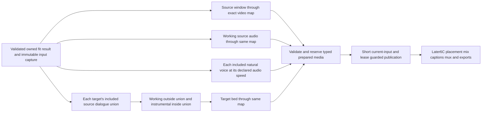

# Owned media rendering after the common fit plan

Status: preparation for6B2B, not implemented media execution or export evidence. Execute only after6B2A's actual CPU primitives pass independent SPEC and distinct QUALITY. Write the detailed execution plan against their final gated signatures and receipts. Master6–9 and the approved SaaS design remain authoritative.

## Existing source contracts to reuse

| Existing module | Actual responsibility | Integration constraint |
| --- | --- | --- |
| `dubbing/fit_plans.py` | Immutable owned capture, current row proofs, normal-dub/preview/original-only purposes, authoritative detail | Do not call `detail()` inside an admission write transaction: it commits its read transaction before full plan/checkpoint arithmetic. Preserve the Q1 repair's short atomic admission followed by fresh response authorization. |
| `dubbing/fit_snapshot.py`, `fit_checkpoint.py` | Strict stored-map, captured-input, producing-operation and summary validation | Load immutable plain data in a short read transaction, then validate the complete map outside SQL. Bind the render to the exact result ID, plan fingerprint and producing command/run/operation. Similar duration is not map identity. |
| `dubbing/analysis.py::media_for` | Current successful extract/separate media for the current source selection | Capture the exact working/instrumental asset IDs, hashes, selection and producing runs. The6B1 snapshot alone does not contain these bed inputs. Never take the newest arbitrary WAV or a stem from another selection. |
| `dubbing/analysis.py::materialize` | Bounded owned storage read and actual byte/hash verification | Perform every storage read outside SQL. Use an explicit render input bound and check cancellation. Materialize only assets resolved through the owning project/workspace. |
| `execution/prepared.py` | Existing private operation cache, pre-write object reservation and short publication | Extend this lifecycle narrowly for typed WAV/MP4 outputs. Keep existing audio callers compatible. Do not add another object store or job state machine. |
| `execution/prepared_objects.py` | Reservation settlement, publication protection and scoped orphan cleanup | A late write, lost lease, cancelled or stale render must remain safe under the same settlement/GC protocol. No direct unlink/delete of another task's storage object. |
| `execution/registry.py`, `service.py`, `context.py` | Guarded command admission, durable lease/retry/cancel, current-input checks and publisher | Add one command-only CPU render stage. CPU retry must not call separation, translation, synthesis or QC. Preserve request generation and prepared checkpoint recovery. |
| `routes/finishing.py`, `routes/assets.py` | Project authorization/CSRF and private asset access | Private rendering artifacts use the existing authorized asset download path. Never return local paths, raw storage keys, provider URLs or credentials. |

The controller re-read the pinned official [VoiceStudio export guide](https://github.com/debpalash/VoiceStudio/blob/5abc33602d17b81805731717b2a117857a98751c/docs/dubbing/export.md) through Agent Reach's GitHub CLI route. The fetched3334-byte guide has SHA-256`43efdff229de391f174ad4e06ab6dacefba4aa198f1c78e2c5189629630dceff`. It supports the selected default track, original comparison, configurable background, caption-after-retime and shared-overlap requirements already recorded in the approved finishing spec. This project writes independent SaaS code; the guide does not prove current exports exist.

## A render is an immutable derivation

A render command captures an already published current feasible fit result, its exact immutable inputs and purpose, a declared CFR frame policy, background crossfade policy and the CPU renderer policy version. It cannot change the parent map, pick different natural outputs, turn a preview into a dub or modify translation/listening/QC records.

Admission must distinguish these three purposes explicitly:

- `dub`: require all captured ordinary-dub eligibility/current accepted audio. Every requested current row of every selected target is present. Any missing/stale/integrity/review blocker rejects admission and later publication.
- `incomplete_preview`: require explicit inherited preview purpose and a current feasible plan. Render only included valid captured voices. Preserve all exclusions and each target's own included-source mask. It remains a preview even if all its rendered bytes validate.
- `original_only`: require the inherited zero-target identity plan. Render source picture and original comparison audio only. No background replacement or invented target/audio readiness is implied.

The existing6B1 `render_eligible` field deliberately authorizes ordinary dubs only. Do not redefine it to promote previews or original-only outputs. A new render API can separately declare allowed purpose and current render status with these rules.

The immutable request records source asset/hash/audio ordinal/absolute selected window, fit command/result/producer/map fingerprint, working and instrumental asset/producer proofs, included natural output/asset/hash/measurement proofs, per-target included original source IDs, frame-rate rational, crossfade policy, renderer version and captured purpose. Every supplied reference must belong to the same project/workspace and intended parent/cell family. Snapshot/row/receipt serialization has explicit bounds. Empty target voice sets must remain visibly empty.

Idempotency uses the canonical complete request fingerprint, not merely project ID or requested duration. Identical admission reuses one command/run; changing a map, selection, source/bed asset, natural output, included mask or actual render setting creates a distinct immutable derivation. A display-name edit is irrelevant. A mix gain or subtitle style is not a6B2B input and must not invalidate these reusable primitives.

## Actual rendering graph

Do not concatenate fitted lines into one sequential timeline. Publish line identity, exact mapped onset, declared speed, measured derived duration/sample count and natural-output identity for6C to place them. A shorter natural voice stays short. Original comparison and every target bed share the exact picture map; per-target beds replace only their own included original-source dialogue union. No mix, implicit gain/protection, caption burn or final audio/video mux is hidden in this increment.

The CPU helper's allowed bounded DSP control approximation is a measured implementation receipt, not a replacement map. Persist its version/error bound separately. Keep the authoritative exact map fingerprint for video, placements and later caption coordinates. Full finite float peaks may exceed unity;6C owns explicit protection.

## Typed prepared media without duplicate-kind loss

The current `store_audio()` writes WAV and `publish_objects()` returns an asset dictionary keyed by kind. That is adequate for existing extraction/separation stages; it loses identity when a render contains many `fit_voice` objects. New rendering must use an explicit object-ID-to-asset-ID mapping and a manifest with a stable semantic key for every artifact. Do not put segment IDs into ad hoc kind names or rely on dictionary overwrite order.

Extend the existing reservation/storage/publisher helpers with a small allowlisted typed-file descriptor for float-WAV and video-only-MP4. Internal safe filename, content type and kind come from code-owned media type choices; client paths/extensions/filter text do not control them. Existing audio wrappers retain their old API and behavior. Validate unique object IDs, expected manifest set/count, owned producing operation/generation, reservation state, settled writes, measured bytes/hash and exact kind/type before publication. Reject duplicate/missing/extra/cross-operation records rather than returning a partial manifest as a successful render.

The private operation checkpoint references the immutable fit result and prepared object IDs/semantic keys/proof fingerprints. Do not duplicate a maximum-size common map plus every media receipt into the default2MiB cache. Per-object bounded evidence can stay in existing prepared metadata and owned artifact records; the checkpoint must still bind that evidence, and all1000 included cells plus at most16 target beds must fit the unchanged cache limit. Do not enlarge every stage's cache to make this convenient.

On recovery, verify the exact checkpoint origin/shape/hashes and every referenced prepared object before reuse. A valid prepared success can publish without re-running CPU or provider work. A damaged checkpoint fails visibly and cannot fall back to model inference. A process death before a prepared checkpoint may require CPU work to restart; old objects remain protected or collectable by the existing owned reservation rules. Do not describe unimplemented partial-output reuse as durable recovery.

## SQL, resources and events

Admission atomically captures authorized inputs and queues the command under the project lock. Full strict-map validation, storage reads/writes, hashing, FFmpeg, DSP and full decode run outside SQL. Publication performs only bounded in-memory proof/CAS comparisons and owned row inserts; it must not materialize media or rebuild/validate the common map. Re-authorize and expire/reload retained ORM identities before any post-commit authoritative response. Repeat the real concurrent settings/name-edit test pattern from Q1 at the supported row bound.

Capture explicit worker render limits and expose truthful capacity failure. Enforce per-file output, aggregate temporary bytes, total wall time and video-frame budgets across the whole command, not a fresh unlimited budget for each of1000 lines. Release each owned local intermediate after its validated prepared write when possible. Source4h/output16h are arithmetic maxima, not a promise that a particular disk/worker configuration can render that case. Missing native capabilities and exceeded budget are explicit errors; never install an AI runtime or silently change engine/quality/language to continue.

Use existing Worker heartbeat/cancel/lease mechanics. Check active status before and after CPU/storage steps and before the short publisher; input changes must suppress stale publication. A cancelled, deleted-project, lease-lost or stale worker cannot publish new current artifacts. Keep natural outputs/QC/listening/source files untouched.

Persist bounded causal events for admission, render start, video, original audio, fitted voice count, target bed count, validation and publication/failure. Public facts use IDs/counts/purpose/policy/fingerprints/actual bounded durations and error codes. No line text, server path, filter script, provider secret or invented percent/cost. Lists paginate summary columns; artifact details/manifest rows paginate separately. A history item cannot claim currentness or full validation from summary-only projection.

## Required integration evidence before closing6B2B

1. Actual tiny generated two-role overlapping fixtures render through owned API→Worker→prepared storage→publication→authorized download. Verify picture markers, original audio/each target bed and fitted-voice pitch/tail/placement receipts against the same plan. Preserve the4→6.5s and separate-ZH5s/JA6s/both6s numeric cases.
2. Per-target preview exclusions retain original speech outside that target's included union. Original-only produces no target claims; normal dub rejects missing/stale/review-blocked rows. Fit/natural/listening/QC data are unchanged by rendering.
3. Two outputs with the same media kind remain separately addressable with correct cell/target lineage. Maximum manifest/cache boundary is exercised using small deterministic fixtures; no1GiB checked-in binary or mock inference is called a real render.
4. Cross-workspace/project/cell/parent/operation object substitutions, wrong source/stem hashes, malformed native or checkpoint receipts, extra/missing manifest objects and wrong MIME/codec fail without publication. New frozen migration tests include populated SQLite and actual PostgreSQL roundtrips and family FK classification.
5. Observe no active SQL transaction during complete map validation, storage I/O, CPU work or decode. Actual competing settings/name edits, deletion, cancel, lease expiry, failed store/late write and publication conflict preserve atomic command admission and historical artifacts. Defaults/timeouts/row bounds are not weakened to pass contention.
6. Recover a valid prepared success after Worker restart without another render or model call; corrupted cache stops visibly. Existing separation/synthesis/QC prepared-object tests remain passing after the narrow typed-media extension. Scoped orphan cleanup cannot delete published/recoverable/newly written objects.
7. Run affected CPU/domain/execution/storage/API tests and one frozen full backend with actual PostgreSQL, static/format/lock checks, then independent SPEC and distinct QUALITY. Record real versions, tolerances, process handles and outputs; missing runtime capabilities are not skipped as a successful gate.

6C, complete web workflow, live remote cloned voices, final paired-language acceptance and deployment artifacts remain required after this increment. The selected YouTube source, separated stems and generated test markers are not dubbed delivery. The user's final request also requires actual post-build test upload/process, playable original-versus-translated videos and notification after those outputs exist.
